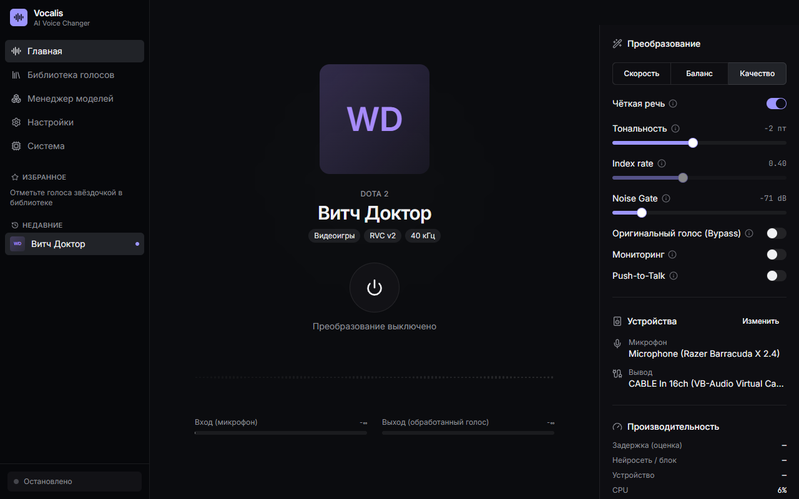
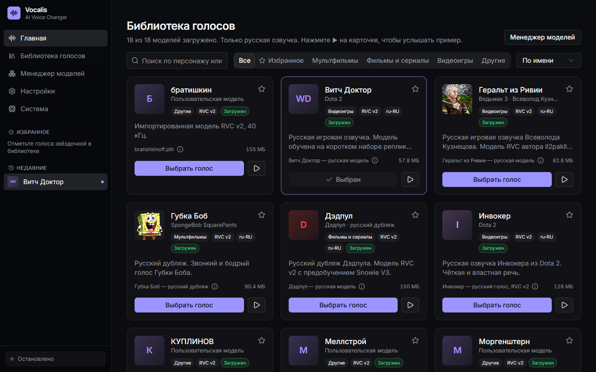
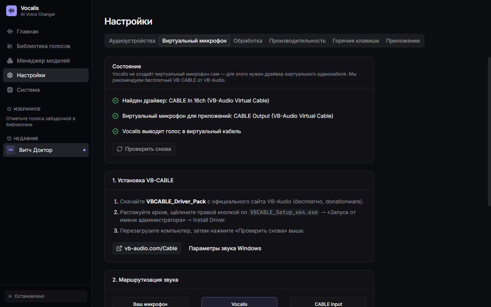

# Vocalis

Vocalis — приложение для Windows, которое меняет голос с микрофона в реальном времени с помощью нейросетей RVC. Можно выбрать голос персонажа, настроить тональность и слышать результат в наушниках или передавать его в Discord, игры и другие приложения.

## Как это работает

Вы выбираете микрофон, голос и устройство вывода, затем включаете преобразование. Нейросеть обрабатывает звук локально на компьютере. После загрузки движка и моделей интернет для преобразования не нужен.

В библиотеке можно прослушать короткие примеры голосов, отметить любимые и выбрать модель. Можно импортировать собственные RVC-модели. Режимы «Скорость», «Баланс» и «Качество» помогают подобрать обработку под компьютер; задержка зависит от оборудования и модели.

Для передачи голоса в Discord или игру нужен отдельно установленный VB-CABLE: в Vocalis выберите вывод **CABLE Input**, а в приложении для общения — микрофон **CABLE Output**. Для прослушивания используйте наушники.

## Начать пользоваться

Скачайте установщик Windows x64 и архив русских голосов в [релизах](https://github.com/melekhovv/vocalis/releases). При первом запуске установите движок и загрузите общие нейросети по подсказкам приложения — для этого нужны интернет и свободное место на диске.

Чтобы добавить голоса из архива, закройте Vocalis и распакуйте папку `voices` в `%LOCALAPPDATA%\Vocalis`. Если голоса уже установлены, повторно распаковывать их не нужно. На скриншотах показано приложение с установленными моделями.

Для NVIDIA доступна CUDA при совместимом драйвере; AMD и Intel используют CPU. Рекомендуется 16 ГБ ОЗУ и 10–15 ГБ свободного места. Скорость работы в реальном времени зависит от компьютера.

Сторонние голосовые модели сохраняют условия и права своих авторов.
